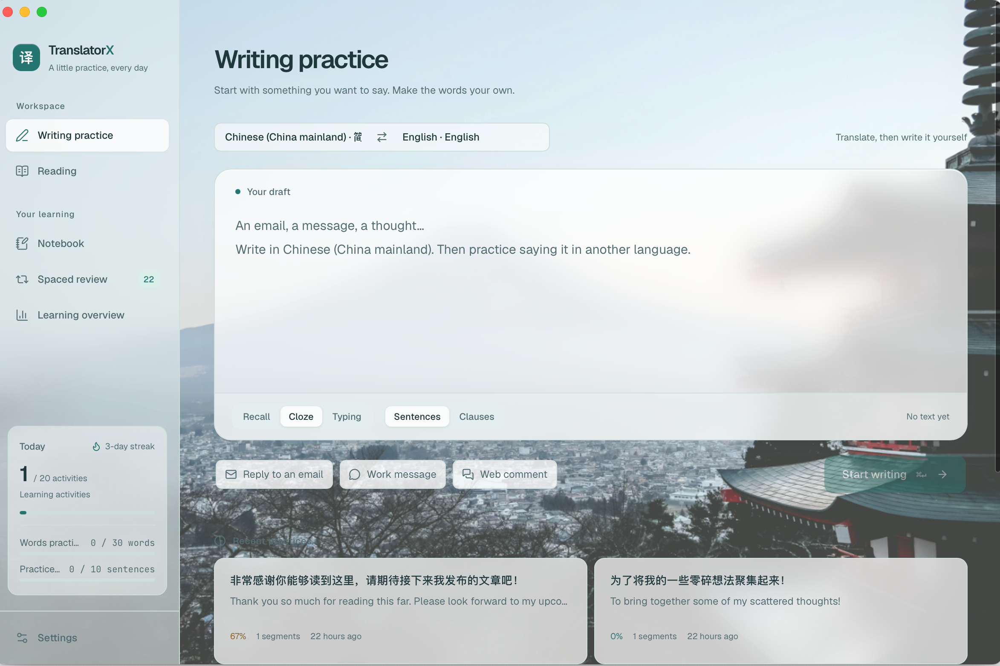

# TranslatorX

**Write it in your native language. Then write it yourself in the language you're learning.**

[](https://github.com/JasonkayZK/translatorx/actions/workflows/ci.yml)

English | [简体中文](README-CN.md)

TranslatorX is a desktop app for learning a language by writing what you actually need to write — an email reply, a chat message, a comment. You draft it in your native language. TranslatorX splits the draft into sentences and translates them, and then you write each sentence yourself in the target language: from memory, by filling in blanks, or by copy-typing. Every attempt is checked word by word and marked up in red pen. At the end you have a finished text ready to send, and the words and sentences you saved come back later for spaced-repetition review.



> Translation helps you understand. Writing it yourself is how you learn.

> [!NOTE]
> The default language pair is Chinese → English, and 18 languages are available on either side. The interface follows your system language (English, Chinese and Japanese), with English fallback.

## Features

### Write (Writing practice)

1. **Draft** in your native language, split into whole sentences or shorter clauses.
2. **Translate** with Google, DeepL or any OpenAI-compatible LLM. An LLM splits and translates in one pass and keeps the tone of your text (email, chat, comment…).
3. **Write each segment yourself** in one of three modes:

   | Mode | You see | You do |
   |---|---|---|
   | Recall | The native sentence only | Write the whole translation from memory |
   | Cloze | The translation with words blanked out | Fill in the blanks (20–100% of the words) |
   | Typing | The full translation | Copy-type it character by character |

4. **Red-pen marking.** Your answer is aligned with the reference word by word, and each word is marked correct, typo, wrong, missing or extra. Case, punctuation and accents can be ignored. Hints reveal the next word bit by bit.
5. **Finish** with a grade (A / B / C / D — shown in the interface as 甲 / 乙 / 丙 / 丁 in Chinese), your stats and the final text — the reference translation or your own version — ready to copy. Weak segments can be practised again, and past sessions can be replayed.

After each segment you can click any word to look it up and save it, bookmark or listen to the sentence, or ask the AI tutor to review what you wrote.

### Quick-translate window and input bubble

Use TranslatorX while typing in any other app, without opening the main window.

- **Open** it with the global shortcut (<kbd>⌘⇧Y</kbd> by default; press again to close), from the tray menu, or — on macOS and Windows — by clicking the red **「译」** bubble that appears at the bottom-right corner of the text field you're typing in. The window opens right next to that text field.
- **Direct insert:** write → translate → edit the result → insert.
- **Practice first:** write → translate → write each sentence yourself → insert. This practice counts toward your stats and streak.
- **Insert** pastes the translation back into the text field you came from, then restores your clipboard (macOS and Windows). Without the macOS Accessibility permission, or on Linux, the translation is copied to the clipboard instead.
- Pin the window on top, adjust its transparency and blur, save the result to your notebook, or continue in the main window for the full practice flow.

The bubble never shows in password fields and can be turned off for individual apps from its right-click menu. Spotlight, Raycast, Alfred, Terminal and iTerm2 are excluded by default.

Closing a window only hides it: TranslatorX keeps running in the tray (the menu bar on macOS), so the shortcut always works. Quit from the tray menu.

### Read (Reading comprehension)

Paste text in the language you're learning and read it sentence by sentence alongside a translation. Click words to look them up and save them with their context, and turn sentences into reverse drills (see the translation, write the original). With an LLM configured, **Breakdown** explains a sentence's vocabulary and grammar, and you can ask the AI tutor follow-up questions.

### Notebook and Review (Spaced repetition)

- Saved words keep the sentence they came from; saved sentences keep their translation. Search them, add notes, drill sentences, and export either list as CSV to import into Anki.
- Review mixes due words and sentences: spell a word from its meaning and a blanked-out example, or write a sentence from its native version.
- Grade each card 1–4 (forgot / hard / good / easy), or press <kbd>↵</kbd> to take the suggested grade. Scheduling is SM-2 style: forgotten cards come back within 10 minutes, and intervals grow with each successful review.

### Progress

Streak and daily goal, practice accuracy, notebook totals, an 8-week chart of saved words and sentences, and a 16-week activity heatmap.

## Translation and AI

| Provider | Setup | Notes |
|---|---|---|
| Google Translate | None | Free. May need a proxy in mainland China. |
| DeepL | API key | Free-plan keys (ending in `:fx`) work too. |
| LLM | Base URL, model, API key | Any OpenAI-compatible API. Translates by context and splits sentences itself. |

The AI features — reviewing your writing, sentence breakdowns and the tutor chat — need an LLM, whichever provider does the translating. Settings include presets for OpenAI, DeepSeek, Qwen, Kimi, OpenRouter and local Ollama (no API key needed), connection tests, and an optional HTTP or SOCKS5 proxy.

Read-aloud uses a system voice for the language when there is one, and Google's online TTS otherwise.

## Getting started

### Requirements

- [Node.js](https://nodejs.org/) 20.19+ or 22.12+, and [pnpm](https://pnpm.io/)
- [Rust](https://rustup.rs/) (stable)
- The [Tauri 2 prerequisites](https://v2.tauri.app/start/prerequisites/) for your OS (Xcode Command Line Tools on macOS)

### Develop

```bash
pnpm install
pnpm tauri dev
```

Then open **Settings** to choose your languages and translation provider.

`pnpm dev` runs the interface alone in a browser at http://localhost:1420. The backend is replaced by a mock (`src/lib/mock.ts`) with sample data and a small built-in phrasebook, which is handy for UI work.

### Build and test

```bash
pnpm tauri build               # development build; use the signed macOS workflow below for installation
pnpm test                      # frontend unit tests (Vitest)
cd src-tauri && cargo test     # backend unit tests
```

### CI and releases

GitHub Actions runs on every push to `main` and on pull requests: frontend checks (`pnpm test`, `pnpm build`) and Rust checks (`cargo clippy`, `cargo test`) on Ubuntu, macOS and Windows.

Pushing a `v*` tag (for example `v1.0.1`) builds installers for macOS (`.dmg`, Apple Silicon and Intel), Linux (`.deb`, `.rpm`, `.AppImage`) and Windows (`.msi`, `.exe`) and publishes them to [GitHub Releases](https://github.com/JasonkayZK/translatorx/releases). The release build verifies that the tag matches the version in `src-tauri/tauri.conf.json`. Release steps and the optional macOS signing secrets are documented in [GitHub Actions](docs/github-actions.md).

### macOS Accessibility permission

The bubble and automatic insertion need Accessibility permission. Use **Settings → Floating window & input bubble → Open System Settings**. Returning to the app refreshes permission; **Check again** also checks immediately. App identity details show the running executable, bundle ID and signature type.

macOS grants trust to a code-signing identity. Ad-hoc signatures are tied to a binary hash, so rebuilding can invalidate trust even while the old System Settings entry stays checked. Reuse a persistent signing certificate for installed builds:

```bash
TRANSLATORX_SIGNING_IDENTITY='Your persistent code-signing identity' pnpm build:macos
bash scripts/verify-macos-signature.sh src-tauri/target/release/bundle/macos/TranslatorX.app
```

See [macOS signing](docs/macos-signing.md) for certificate setup, migration and upgrade verification. The app never resets system permissions automatically. Migrating from an old ad-hoc identity may require one initial reauthorization.

### Appearance, interface language and learning history

- Choose Paper, Glass or Studio, each with light, dark or system mode, for the main and floating windows; the floating window can also follow the main window, and the bubble follows the floating window.
- English, Chinese and Japanese interfaces follow the system by default, with English fallback. Override the interface language in Settings.
- The macOS Dock icon is shown by default. Turn it off to use the menu bar; closing a window still only hides it.
- Translation, reading, intentional word lookup, completed practice and review grades create local learning history without favorites. Explore date ranges, trends, a heatmap, type/language distributions and expandable, deletable history.
- Accuracy is weighted by practiced words; streaks count actual learning. Existing practices migrate once. Older unrecorded translations cannot be recovered. Retry a failed practice save before starting the next practice; the current result is retained.

## Keyboard shortcuts

On Windows and Linux, use <kbd>Ctrl</kbd> instead of <kbd>⌘</kbd>.

| Where | Keys | Action |
|---|---|---|
| Anywhere | <kbd>⌘⇧Y</kbd> | Open / close the quick-translate window (configurable) |
| Main window | <kbd>⌘1</kbd> … <kbd>⌘6</kbd> | Switch pages |
| Write / Read | <kbd>⌘↵</kbd> | Start practice / translate |
| Practice | <kbd>↵</kbd> | Check, then go to the next segment |
| Practice | <kbd>⌘/</kbd> · <kbd>⌘J</kbd> · <kbd>⌘E</kbd> · <kbd>⌘S</kbd> | Hint · read aloud · show answer · save sentence |
| Review | <kbd>1</kbd>–<kbd>4</kbd> · <kbd>↵</kbd> | Grade · take the suggested grade |
| Quick window | <kbd>⌘↵</kbd> · <kbd>Esc</kbd> | Next step (translate / insert) · hide |

## Data and privacy

- Settings, notebook, review schedule and practice history live in a local SQLite database, `translatorx.db`, in the app data folder (on macOS: `~/Library/Application Support/com.translatorx.desktop/`). API keys are stored there in plain text.
- Text leaves your machine only when you translate, look up a word, use an AI feature or online read-aloud, and only goes to the service involved: your translation provider, your LLM endpoint, or Google TTS. All requests are made by the Rust backend.

## Project structure

```
├── index.html, mini.html, bubble.html   # main window, quick-translate window, input bubble
├── src/                                 # React + TypeScript frontend
│   ├── pages/                           # Write, Read, Notebook, Review, Stats, Settings
│   ├── mini/                            # quick-translate window
│   ├── bubble/                          # input bubble (plain TS)
│   ├── components/                      # shared UI
│   └── lib/                             # API bridge, answer checking, segmentation, speech, mock backend
├── src-tauri/src/                       # Rust backend
│   ├── commands.rs, translate.rs        # commands; Google / DeepL / LLM / TTS
│   ├── db.rs, srs.rs, settings.rs       # SQLite storage, review scheduling, settings
│   ├── quick.rs, windows.rs             # quick-translate window and bubble
│   ├── geometry.rs, rules.rs            # window placement, text-field rules
│   └── macos/                           # Accessibility, focus tracking, paste-back
├── .github/workflows/                   # CI and release pipelines
└── docs/                                # design notes (Chinese)
```

## Tech stack

[Tauri 2](https://tauri.app/) · Rust · React 19 · TypeScript · Vite · Tailwind CSS 4 · zustand · SQLite (rusqlite)

## Known limitations

- The input bubble and automatic insertion work on macOS and Windows, not Linux. On Windows they cannot reach apps running as administrator.
- Insertion sends ⌘V / Ctrl+V by key position, so pasting may fail with non-QWERTY layouts such as Dvorak.
- Apps whose interface isn't exposed to Accessibility (macOS) or UI Automation (Windows) get no bubble. The shortcut still works there.
- Transparent windows need Tauri's `macOSPrivateApi`, which rules out the Mac App Store.
